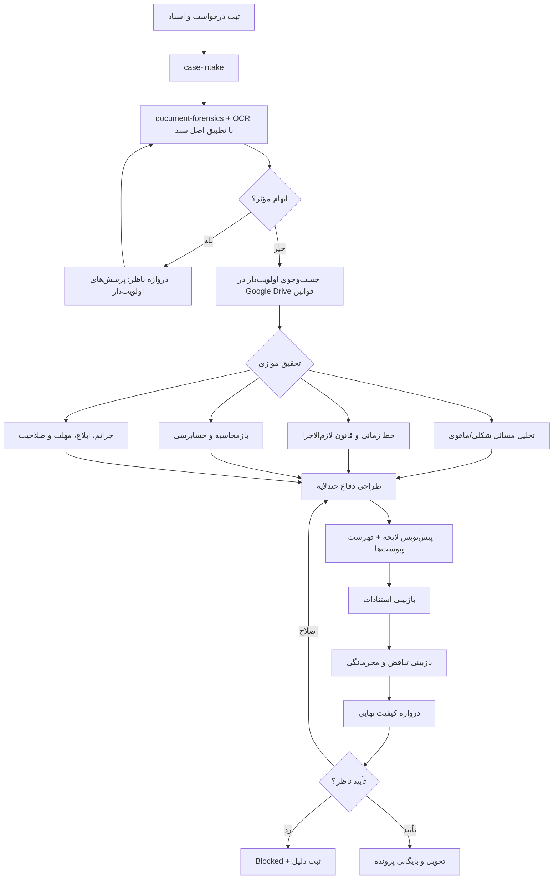

# ورک‌فلو نظارت‌شده تحقیق و تنظیم لوایح مالیاتی ایران

این طراحی بر اساس پرامپت ارسالی، هسته فعلی MousaviTax، MKA-Core، موتور دانش و کتابخانه قوانین ساخته شده است. هدف، **همکاری چند ایجنت متخصص با کنترل کامل ناظر انسانی** است؛ هیچ ایجنتی مجاز به صدور یا ارسال مستقل لایحه نیست.

## اصل معماری

> ایجنت‌ها تحقیق، استخراج، مقایسه و پیشنهاد می‌کنند؛ ناظر انسانی تنها مرجع رفع ابهام، تصویب و تحویل نسخه نهایی است.

## اتصال چهار مخزن

| منبع | نقش در ورک‌فلو |
|---|---|
| `taxmsvj-cmyk/remix-of` | مرجع رابط/اسکلت محصول و قراردادهای اجرایی فعلی |
| `ziyamka2026-art/MKA-Core` | پنل پرونده، حافظه، گفت‌وگو، احراز هویت و API تعامل با کاربر |
| `ziyamka2026-art/mka-core-engine` | هسته UI/Brain و مسیرهای پرسش و پاسخ مبتنی بر RAG |
| `taxmsvj-cmyk/mka-law-library` | فهرست و متن قوانین، مواد، بخشنامه‌ها و جست‌وجوی منابع |
| `mousavitax-platform` | لایه ارکستراسیون، قرارداد شواهد، کنترل دسترسی، حسابرسی و سرویس‌های تخصصی |

## گراف اجرای پرونده



## ۱۲ ایجنت تخصصی

1. **case-intake**: شناسنامه پرونده، تفکیک مؤدی/ملک/قرارداد/معامله و تشخیص داده‌های مفقود.
2. **document-forensics**: خواندن اصل سند، OCR کنترل‌شده، استخراج برگ تشخیص/مطالبه/قطعی، گزارش رسیدگی، اظهارنامه و ارقام.
3. **drive-research**: جست‌وجوی مخزن Google Drive قبل از منابع دیگر؛ ثبت شماره، تاریخ، نوع، صادرکننده و لینک هر منبع.
4. **timeline-agent**: سال عملکرد، زمان رویداد، تاریخ تصویب/ابلاغ/لازم‌الاجرا شدن و بررسی عطف‌به‌ماسبق.
5. **legal-issues**: ماتریس مسائل حقوقی؛ تفکیک ایراد شکلی از ماهوی و زنجیره «ادعا ← مبنای قانونی ← دلیل ← سند ← نتیجه».
6. **accounting-check**: بازحساب مبلغ اظهارشده، مورد قبول، تشخیص‌شده، قطعی، جرائم و مالیات قابل پرداخت.
7. **penalty-procedure**: مبنای جریمه، تکلیف، تاریخ تخلف، ابلاغ، مهلت، صلاحیت، حق دفاع و امکان بخشودگی.
8. **defense-strategy**: دفاع اصلی ← تکمیلی ← علی‌البدل ← درخواست احتیاطی، همراه با ریسک و سطح اطمینان.
9. **drafting-agent**: تولید پیش‌نویس رسمی فقط بر مبنای واقعیت‌ها و استنادات ثبت‌شده.
10. **citation-verifier**: کنترل ماده، تاریخ، صادرکننده، اعتبار و ارتباط واقعی استناد با ادعا.
11. **contradiction-reviewer**: کنترل تناقض، تعمیم ناروا میان پرونده‌ها و نشت اطلاعات محرمانه.
12. **quality-gate**: کنترل نهایی نام، شماره، تاریخ، ارقام، استنادات، پیوست، خواسته، ادبیات و محرمانگی.

## دروازه‌های غیرقابل دورزدن

- **Clarification Gate**: تا رفع ابهام مؤثر، خروجی فقط گزارش تحقیق و سؤال است.
- **Evidence Gate**: پاسخ مالیاتی بدون منبع قابل ردیابی وارد تدوین نهایی نمی‌شود.
- **Citation Gate**: نقل قول قطعی از قانون/رأی/بخشنامه بدون متن یا منبع معتبر ممنوع است.
- **Contradiction & Privacy Gate**: تناقض حل‌نشده یا ترکیب اطلاعات دو مؤدی، انتشار را متوقف می‌کند.
- **Final Human Review**: تنها ناظر مالک پرونده می‌تواند approve/reject/request_changes انجام دهد.

## قرارداد خروجی هر مرحله

```json
{
  "status": "SUCCESS|INSUFFICIENT_DATA|CLARIFICATION_REQUIRED|ERROR",
  "facts": {"certain": [], "probable": [], "unknown": []},
  "citations": [{"source_type":"circular", "source_id":"", "title":"", "url":"", "effective_date":""}],
  "issues": [],
  "risks": [],
  "actions": [],
  "trace_id": "uuid",
  "human_review_required": true
}
```

## API پیشنهادی

- `POST /agents/legal-workflow/start`
- `POST /agents/legal-workflow/{id}/intake`
- `POST /agents/legal-workflow/{id}/clarification`
- `POST /agents/legal-workflow/{id}/research`
- `POST /agents/legal-workflow/{id}/draft`
- `POST /agents/legal-workflow/{id}/approve`
- `POST /agents/legal-workflow/{id}/deliver`
- `GET /agents/legal-workflow/{id}`

پیاده‌سازی ماشین‌حالت در `packages/agent-core/legal_workflow.py` قرار دارد و فعلاً provider-agnostic است؛ اتصال مدل، Drive، OCR و دیتابیس از طریق adapter انجام می‌شود.

## راهنمای عملیات ناظر

1. پرونده را با شناسه مستقل ایجاد کنید.
2. اسناد و درخواست اولیه را ثبت کنید.
3. اگر `NEEDS_CLARIFICATION` آمد، فقط پرسش‌های مؤثر را پاسخ دهید.
4. منابع Drive و منابع رسمی را کنترل کنید.
5. پیش‌نویس را در وضعیت `HUMAN_REVIEW` بخوانید.
6. یکی از `approve`، `request_changes` یا `reject` را با یادداشت ثبت کنید.
7. فقط بعد از `APPROVED` عملیات `deliver` ممکن است.
8. نسخه نهایی و فهرست پیوست‌ها در پرونده بایگانی شود.

## مرزهای ایمنی

- دسترسی مستقیم ایجنت به دیتابیس خام ممنوع؛ فقط APIهای دارای مجوز.
- تمام عملیات دارای `actor_id`، `workflow_id` و رویداد حسابرسی هستند.
- داده‌های پرونده‌ها namespace مستقل دارند و به پرونده دیگر تعمیم داده نمی‌شوند.
- حالت پیش‌فرض ایجنت‌ها `suggest` یا `read_only` است.
- حذف دائمی، ارسال رسمی، امضای الکترونیک و اقدام بیرونی در این چرخه خودکار نیست.
